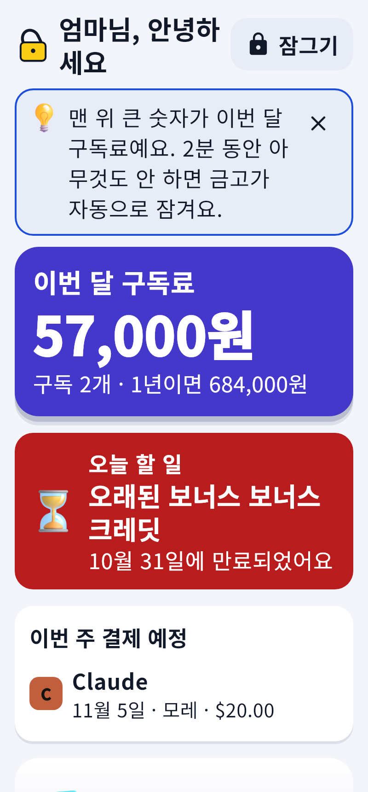
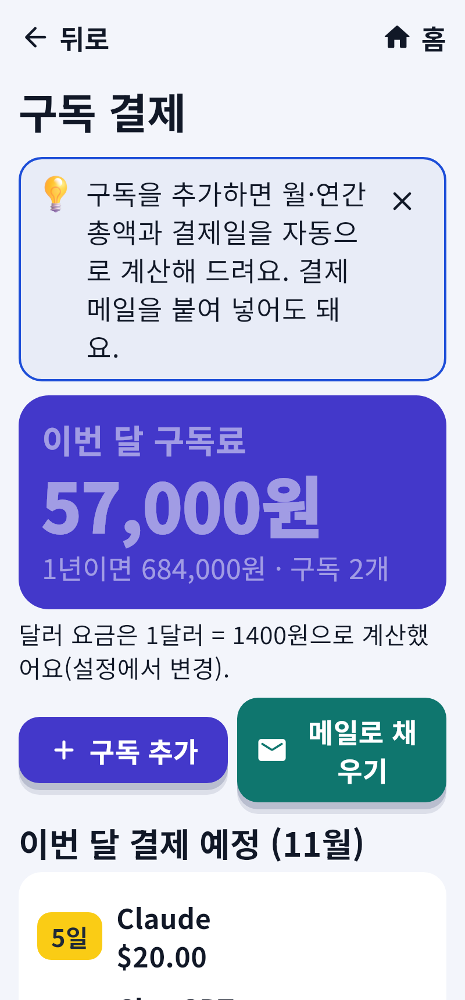
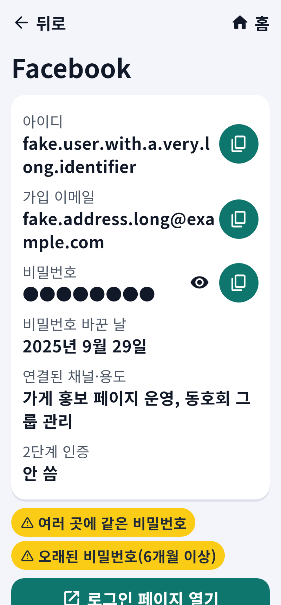
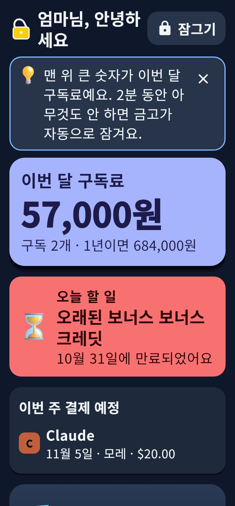

# 로그인 계정과 구독 결제 관리 비서

유료 구독(Claude, ChatGPT, 제미나이, 힉스필드, 피그마 …), 무료 크레딧·체험판 만료일,
SNS 계정(페이스북, X, 스레드, 카카오톡 …)과 비밀번호를 **한곳에 안전하게** 모아 주는 앱입니다.

| 홈 | 구독 결제 | 계정 | 어두운 모드 |
|---|---|---|---|
|  |  |  |  |

## 무엇을 할 수 있나요?

- **구독 결제 한눈에**: 서비스별 월 요금, 결제일, 결제 카드(끝 4자리만), 다음 결제일, 한 달·1년 총액, 이번 달 결제 예정표
- **만료 알림**: 무료·보너스 크레딧, 체험판 마감 7일 전·1일 전, 구독 결제 며칠 전에 알림
- **정리 도우미**: 오래 안 쓴 구독·비슷한 구독을 찾아 해지 후보로 추천, 해지 방법 안내(해지는 직접)
- **계정·비밀번호**: 아이디, 가입 이메일, 용도, 비밀번호 보관, 튼튼한 비밀번호 만들기, 복사하면 30초 뒤 자동 삭제
- **금고 건강 보고서**: 여러 곳에 같은 비밀번호, 약한 비밀번호, 오래된 비밀번호 찾기
- **음성 비서**: "이번 달 구독료 얼마야?", "힉스필드 크레딧 언제 끝나?", "넷플릭스 해지 후보에 넣어", 아침 브리핑 (비밀번호는 절대 소리로 읽지 않아요)
- **메일로 채우기**: 결제 영수증 메일을 붙여 넣거나 지메일을 연결하면 자동으로 채워 드려요
- **구글 비밀번호 관리자 CSV 가져오기**, **암호화 백업 파일**
- 글씨 크기 3단계, 밝게·어둡게·고대비 화면, 움직임 줄이기, 여러 사람이 한 기기에서 따로 쓰기

## 1. 설치하기

GitHub 저장소 오른쪽의 **Releases → 가장 최신 버전**에서 기기에 맞는 파일을 내려받습니다.

| 기기 | 파일 | 설치 방법 |
|---|---|---|
| 안드로이드 폰 | `account_vault-버전-android.apk` | 폰에서 파일을 누르기 → "출처를 알 수 없는 앱 허용" |
| 윈도우 PC | `account_vault-버전-windows-setup.exe` | 실행 → 안내대로 설치 |
| 맥 | `account_vault-버전-macos.zip` | 압축을 풀고 앱을 "응용 프로그램" 폴더로 → 처음 한 번은 오른쪽 클릭 → "열기" |
| 리눅스 | `account_vault-버전-linux.tar.gz` | 압축을 풀고 `account_vault` 실행 |

> 아이폰은 준비 중입니다. 지금 파일은 앱 서명 전 **시험용**입니다(`docs/배포준비.md`).

## 1-1. 새 버전으로 바꾸기 (업데이트)

- **설치하기 전에 복구 코드가 종이에 적혀 있는지 꼭 확인하세요.**
- **설치 = 덮어쓰기**입니다. 금고(구독·계정·비밀번호)는 앱 파일이 아니라 사용자 자료 폴더
  (맥 `~/Library/Application Support`, 윈도우 `%APPDATA%`, 안드로이드 앱 자료)에 있어 **그대로 남고, 같은 마스터 비밀번호로 열립니다.**
- 가장 쉬운 방법: 앱을 열고 **설정 → 맨 위 "업데이트 확인"** → "백업하고 내려받아 설치".
  앱이 금고를 먼저 자동 백업하고, 내려받은 파일이 원본과 같은지(해시) 확인한 뒤 설치를 시작합니다. 다르면 설치하지 않습니다.
  - 안드로이드: 설치 화면에서 "업데이트"
  - 윈도우: 설치 프로그램이 열리고 앱이 잠시 닫힘
  - 맥·리눅스: 내려받은 폴더가 열림 → 압축을 풀어 기존 앱을 바꾸기
- 안드로이드는 서명 키가 고정되어 있어야 업데이트가 됩니다 → `docs/안드로이드서명키.md` (한 번만)
- **앱을 "삭제"하지 마세요.** 안드로이드에서 앱을 삭제하면 금고도 지워집니다. 꼭 필요하면 먼저 백업 파일을 PC 로 옮기세요.

## 2. 처음 켰을 때 — 마스터 비밀번호와 복구 코드 (가장 중요)

앱을 처음 켜면 안내가 나옵니다: 글씨 크기 → **마스터 비밀번호** → **복구 코드** → 지문·얼굴 → 알림·마이크.

### 마스터 비밀번호
- 앱을 여는 **단 하나의 비밀번호**입니다. 이 비밀번호로 모든 정보가 암호화됩니다.
- **잊으면 누구도(만든 사람도) 되찾아 드릴 수 없습니다.** 서버에 보관하지 않기 때문입니다.
- 8글자 이상, 남이 짐작하기 어렵게. 예) 좋아하는 문장 세 단어를 이어 붙이기.
- **종이에 적어** 집 안 안전한 곳(서랍, 금고)에 두세요. 폰 메모장·사진으로 남기지 마세요.

### 복구 코드
- 마스터 비밀번호를 잊었을 때 **딱 한 번** 쓸 수 있는 25글자 코드입니다. 예) `7K3QD-M9XAT-…`
- 화면에 한 번만 보여 줍니다. **종이에 옮겨 적거나 "파일로 저장" 후 인쇄**하고, 저장한 파일은 지우세요.
- 마스터 비밀번호 종이와 **다른 곳**에 보관하면 더 안전합니다.
- 복구 코드로 열면 바로 새 마스터 비밀번호를 정하고, **새 복구 코드**를 다시 받습니다(옛 코드는 못 씀).
- 설정 → "복구 코드 새로 만들기"로 언제든 새로 받을 수 있습니다.

### 알아 두면 좋은 것
- 2분 동안 아무것도 안 하면 **자동으로 잠깁니다**(설정에서 1·2·5·10분).
- 비밀번호를 여러 번 틀리면 잠시 기다려야 합니다(도둑이 맞힐 때까지 시도하지 못하게).
- 알림에는 개인 정보가 보이지 않습니다("확인할 항목이 있어요"만). 앱을 열면 놓친 알림을 먼저 보여 줍니다.
- 휴대폰을 바꾸기 전에 **설정 → 백업 → 백업 파일 만들기**로 파일을 만들어 USB·PC에 보관하세요.
  백업 파일도 암호화되어 있어 그때의 마스터 비밀번호가 있어야 열립니다.

## 3. 지메일 연결하기 (선택)

> 앱 안 **설정 → 지메일 → "지메일 연결 도우미"**에 아래 순서가 바로가기 버튼과 함께 있어요. 4번에서 받은 JSON 파일은 "구글 JSON 파일 불러오기"로 넣으면 됩니다. 구글 "테스트" 상태 앱은 7일마다 연결이 끊기니 그때 "다시 연결"을 누르세요.

연결하지 않아도 모든 기능을 쓸 수 있습니다(직접 입력, 메일 내용 붙여 넣기).
연결하면 최근 60일 결제·크레딧 메일을 **읽기만** 해서 자동으로 채워 드립니다. 메일 내용은 저장하지 않습니다.

1. https://console.cloud.google.com 에 구글 계정으로 로그인 → 새 프로젝트 만들기
2. "API 및 서비스 → 라이브러리"에서 **Gmail API** 를 찾아 "사용" 누르기
3. "OAuth 동의 화면": 사용자 유형 **외부**, 앱 이름 아무거나, 테스트 사용자에 **내 지메일 주소** 추가
4. "사용자 인증 정보 → 사용자 인증 정보 만들기 → OAuth 클라이언트 ID" → 애플리케이션 유형 **데스크톱 앱**
5. 만들어진 **클라이언트 ID**(와 클라이언트 보안 비밀번호)를 복사
6. 앱 → 설정 → 지메일 연결 → 붙여 넣고 **"구글 계정으로 연결"** → 브라우저에서 허용
7. 구독 결제 → "메일로 채우기" → **"지메일에서 최근 결제 메일 찾기"**

연결이 끊기면(비밀번호 변경 등) 같은 화면에서 "다시 연결"을 누르면 됩니다.

## 4. AI 연결하기 (선택)

결제 메일을 규칙만으로 알아보지 못할 때 Claude AI 가 도와줍니다.
1. https://console.anthropic.com 에서 API 키 만들기
2. 앱 → 설정 → AI 연결 → 키 붙여 넣기, 모델 고르기, **한 달 사용 한도(원)** 정하기
3. 메일 1통 분석 예상 비용이 화면에 표시되고, 한도를 넘으면 자동으로 멈춥니다.
   (가장 저렴한 모델은 1통에 1원도 안 됩니다.) 카드 번호처럼 보이는 숫자는 지운 뒤 필요한 부분만 보냅니다.

## 5. 다른 비밀번호 관리자에서 옮겨 오기

구글 비밀번호 관리자(https://passwords.google.com) → 설정 → **비밀번호 내보내기** → CSV 파일 저장 →
앱 → 계정·비밀번호 → **CSV 가져오기**. 가져온 뒤 **CSV 파일은 꼭 지우세요**(비밀번호가 그대로 적혀 있습니다).

## 5-1. 앱 꾸미기
설정 → 앱 꾸미기: 표시 이름, 색 테마, 눈에 안 띄는 "계산기"·"메모" 이름·아이콘(안드로이드는 홈 화면 아이콘까지).

## 6. 문제가 생기면

- 설정 → **문제 신고(기록 내보내기)** 로 파일을 만들어 보내 주세요. 비밀번호·계정 정보는 들어 있지 않습니다.
- 지문이 안 되면 마스터 비밀번호로 열면 됩니다.
- 음성 인식이 안 되는 기기(리눅스 등)에서는 글자로 물어보면 됩니다.

---

### 개발자용

- Flutter 3.47.9 / Dart 3.13. `flutter test test/compat`(금고 호환, 가장 먼저) → `flutter test`, `flutter analyze`, `flutter build linux|apk|windows|macos`
- 구조: `lib/core`(암호화·금고·로그) · `lib/data`(모델·버전 변환·백업) · `lib/logic`(계산·음성·메일) · `lib/app`(상태·운영체제 연결) · `lib/ui`(테마 파일 `ui/theme/tokens.dart` 하나, 화면)
- 문서: `PLAN.md`, `PROGRESS.md`, `DECISIONS.md`, `BLOCKERS.md`, `docs/보고`, `docs/검증`, `docs/배포준비.md`, `docs/다음단계.md`
- 보고서용 화면 캡처: `flutter test tool/screenshots_test.dart`
